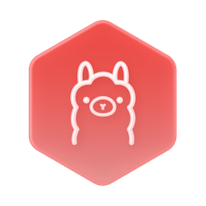

<h1>
  
  &nbsp;ollama
</h1>

> Made for [Hub](https://hub.v57.dev)

Share your Ollama models with Hub network. Run on multiple devices, connect to a single Hub and it will automatically split the load between them! Very good for agents and server stuff
## Normal request

```ts
const request: PostRequest
const response: ChatResponse = await service.send('llm/local', request)
```
## Stream request
```ts
const request: StreamRequest
for await (const chunk of service.values('llm/local', request)) {
  // chunk: ChatResponse
}
```
# List models
```ts
const response: ListResponse = await service.send('llm/list')
```
## Types
```ts
interface ChatRequest {
    model: string;
    messages?: Message[];
    stream?: boolean;
    format?: string | object;
    keep_alive?: string | number;
    tools?: Tool[];
    think?: boolean | 'high' | 'medium' | 'low';
    options?: Partial<Options>;
}
interface Message {
    role: string;
    content: string;
    thinking?: string;
    images?: Uint8Array[] | string[];
    tool_calls?: ToolCall[];
    tool_name?: string;
}
interface ChatResponse {
    model: string;
    created_at: Date;
    message: Message;
    done: boolean;
    done_reason: string;
    total_duration: number;
    load_duration: number;
    prompt_eval_count: number;
    prompt_eval_duration: number;
    eval_count: number;
    eval_duration: number;
}
interface ModelResponse {
    name: string;
    modified_at: Date;
    model: string;
    size: number;
    digest: string;
    details: ModelDetails;
    expires_at: Date;
    size_vram: number;
}
interface ModelDetails {
    parent_model: string;
    format: string;
    family: string;
    families: string[];
    parameter_size: string;
    quantization_level: string;
}


interface ListResponse {
    models: ModelResponse[];
}
type PostRequest = ChatRequest & { stream: false }
type StreamRequest = ChatRequest & { stream: true }
```

## Service reference

### What it does

hub-ollama shares the models of an [Ollama](https://ollama.com) running on this machine with a hub. Callers send a
chat request to `llm/local` and get the reply at once or as a stream; `llm/list` lists the pulled models. The request
and the answers are Ollama's own (`/api/chat`, `/api/tags`, through the `ollama` package). The shared part of the
request (`model`, `messages`, `options`, `keep_alive`) is what [hub-lmstudio](https://github.com/v57/hub-lmstudio)'s
`llm/local` takes too. Run it on several machines and the hub splits the calls between them; the hub runs at most 4
calls at once on each.

### Installing it on a Hub

Ollama must be running on the same machine, at its default address `http://127.0.0.1:11434`, with the models pulled
(`ollama pull <model>`). The service has no setting for another Ollama address.

**From the launcher.** The launcher's app catalogue ([hub-store](https://github.com/v57/hub-store) `apps.json`) lists
it as **Ollama Service** (`v57/ollama`, repository `v57/hub-ollama`). An owner installs it in the Hub app:
**Launcher**, **Get More**, then **Get** (see the Hub app guide's
[Launcher](https://github.com/v57/hub-app/blob/main/docs/Launcher.md) page). The launcher on the hub's machine clones
the repository into its `apps/` folder (`~/Hub/Launcher/apps/hub-ollama` when it was started with the
[`hub`](https://github.com/v57/hub) CLI), runs `bun install --production --frozen-lockfile` and starts it with `bun .`.
To share another machine's Ollama, install it on that machine's launcher, or run it there by hand.

**By hand:**

```sh
git clone https://github.com/v57/hub-ollama.git && cd hub-ollama
bun install
HUB=ws://127.0.0.1:1997 bun .
# or pass the hub's address as the first argument: bun . ws://127.0.0.1:1997
```

Configuration:

| Name | Kind | What |
| --- | --- | --- |
| `HUB` | environment | The hub's address. A bare number is a port on this machine. Default `1997`. |
| first argument | argument | The hub's address; wins over `HUB`. |
| `auth` | file in the working directory | The service's own key, created on the first run. Keep it: the hub approves the service by this key. |

It needs no secrets. The hub-service SDK reads a few more variables (device key, instance name); see the
[hub-service README](https://github.com/v57/hub-service).

**Hosting approval.** When the service connects, it asks the hub to post `llm/local` and `llm/list`. The hub routes no
calls to it until an owner allows that: the Hub app lists the paths as **Needs approval** on **Services** and the
request on **Requests**, where **Allow** approves exactly those paths for the service's key. The owner call behind it
is `hub/host/update { key, allow: [paths] }`. A service whose key is an owner's needs no approval.

### APIs

The descriptions come from `descriptions.ts`, which the service sends to the hub; `hub/api/list` returns them (the Hub
protocol, `Docs/Devices/protocol.md` section 15 in the Hub workspace).

| Path | Kind | Title | Takes | Returns |
| --- | --- | --- | --- | --- |
| `llm/local` | post | Chat with a local model | Ollama `ChatRequest` | one Ollama `ChatResponse`: the reply in `message`, with token counts and timings |
| `llm/local` | stream | Stream a chat with a local model | Ollama `ChatRequest` | `ChatResponse` chunks, each with the next piece of `message.content` (or `message.thinking`); the last has `done: true` and the counts |
| `llm/list` | post | List local models | nothing | Ollama `ListResponse`, `{ models: [{ name, model, modified_at, size, digest, details }] }` |

The request is `{ model, messages, options?, keep_alive?, format?, tools?, think?, stream? }`, sent to Ollama as it is
(see [Types](#types)):

- `model` is a `name` from `llm/list`; `messages` have `role`, `content`, and optionally `images` (base64, for vision
  models), `thinking`, `tool_calls` and `tool_name`.
- `options` are Ollama's model parameters (`temperature`, `top_p`, `top_k`, `seed`, `num_predict`, `num_ctx`, `stop`,
  ...). `keep_alive` is how long the model stays loaded. `format` is `"json"` or a JSON schema for the answer.
  `think` turns thinking on or off, or sets how hard (`high`, `medium`, `low`).
- `stream` is ignored: the kind of call decides.
- Calls fail with Ollama's error when the model isn't pulled or Ollama isn't running.

hub-lmstudio serves the same paths with OpenAI's answer shapes. On a hub where both run, the hub splits `llm/local`
and `llm/list` calls between them, so a caller may get either shape; `hub/api/list` shows the description of the
provider that described the path first. Keep one of them per hub, or make callers handle both. The same goes for
several machines running hub-ollama: `llm/list` answers from one of them, so pull the same models on each.

### Permissions

Both paths are guarded by a permission of their own path (`access.ts`): before the handler runs, the service asks the
hub with `hub/grant/check` whether the caller holds a grant of `llm/local` (or `llm/list`). The post and the stream of
`llm/local` share the one permission.

| Caller | `llm/local` (post and stream), `llm/list` |
| --- | --- |
| Anonymous (no key) | refused, `unauthorized` |
| A key or device without a grant | refused, `forbidden` |
| An owner of the hub | allowed |
| A caller an owner granted the path (or a prefix of it) | allowed |

This holds on every hub. On a `default-deny` hub (every new hub starts in it) the hub also refuses ungranted callers
before the call reaches the service; on an older `default-allow` hub the service's own check is what stops them. The
Hub app shows the permission as **Run models**.

To let another device run models, an owner adds a grant (Hub protocol section 6):

```
hub/grant/add { "subject": { "device": "<device id>" }, "object": { "prefix": "llm/" } }
```

`subject` may also be `{ "key": "<public key>" }`, `{ "group": "<group>" }` or `{ "everyone": true }`; `object` may be
`{ "path": "llm/list" }` for one path. In the Hub app, the same is **Grant** on a device's **Access** list. The check
reads grants, so give access with a grant.

### Testing

```sh
bun install
bun test
```

- `access.test.ts` checks that every path `index.ts` registers is guarded, and that anonymous and ungranted callers are
  refused while owners and granted callers pass (the hub's grant check is stubbed).
- `descriptions.test.ts` checks that every registered path and kind is described, and that the schemas stay in the
  subset hub-service accepts (hub-service `docs/api-descriptions.md`).

No test talks to Ollama. To try it, start Ollama with a model pulled, run the service against a local hub, approve
it, and call `llm/list`, then `llm/local`.
